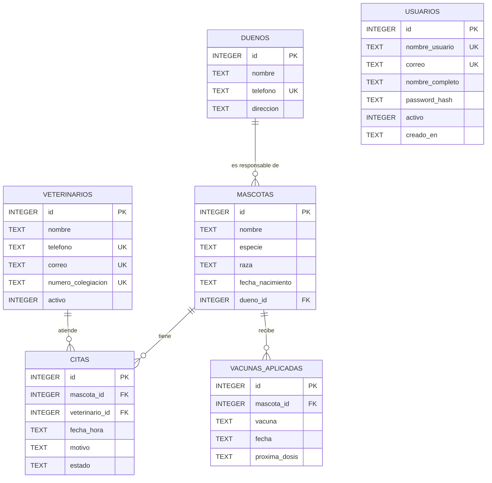
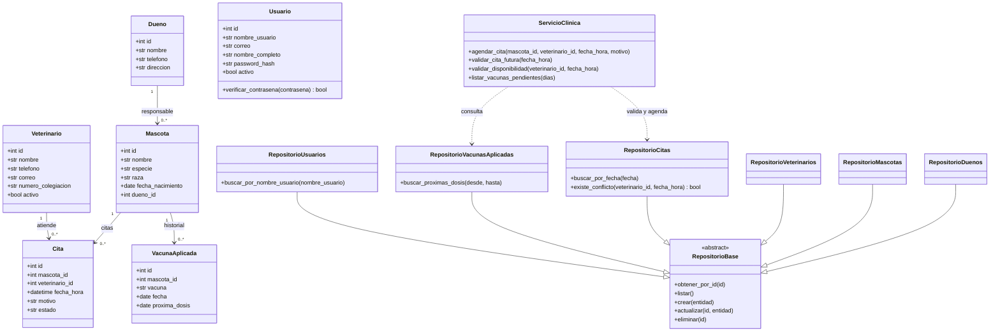

# Diseño de la clínica veterinaria

**Estudiante:** Alisson Daniela Ocampo Maldonado
**Proyecto:** Sistema de gestión para una clínica veterinaria
**Asignatura:** Programación III (IS-151)

## Diagrama entidad-relación

`PK` es llave primaria, `FK` es llave foránea y `UK` indica un valor único. Un dueño puede tener varias mascotas; cada mascota tiene un solo dueño. Las citas relacionan una mascota con un veterinario, y el historial de vacunas pertenece a una mascota. Los usuarios administran el acceso al sistema y no representan una relación de atención médica.

## Diagrama UML de clases

## Reglas del diseño

- Un veterinario no puede tener dos citas con la misma fecha y hora.
- No se agenda una cita en una fecha pasada.
- No se puede eliminar un dueño que todavía tiene mascotas.
- Las vacunas pendientes son las dosis cuya fecha está entre hoy y los próximos siete días.
- Las contraseñas se guardan como hashes, nunca como texto plano.
- La base de datos se crea con [`crear_bd.sql`](../crear_bd.sql), que incluye registros de prueba.
